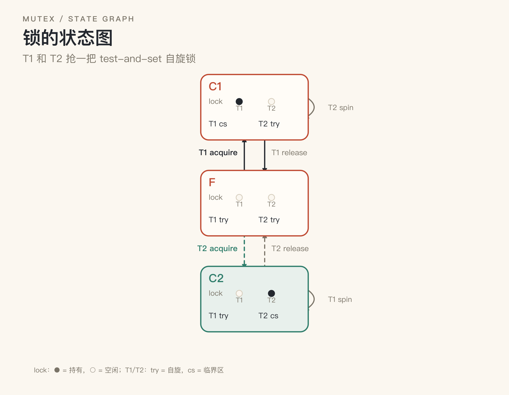
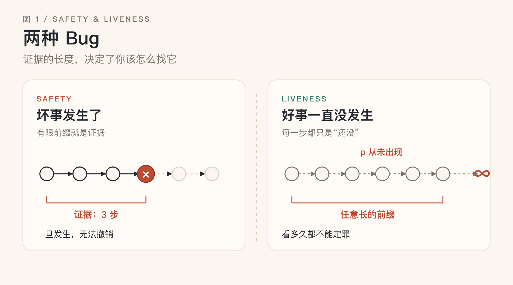
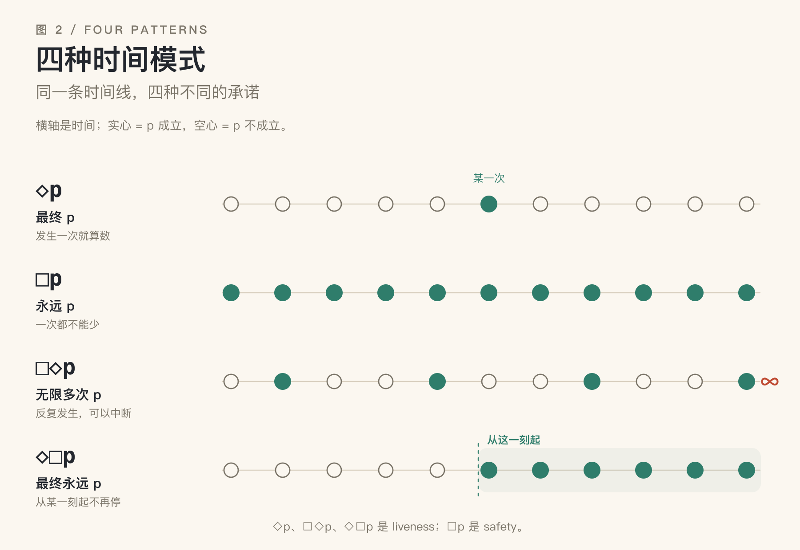
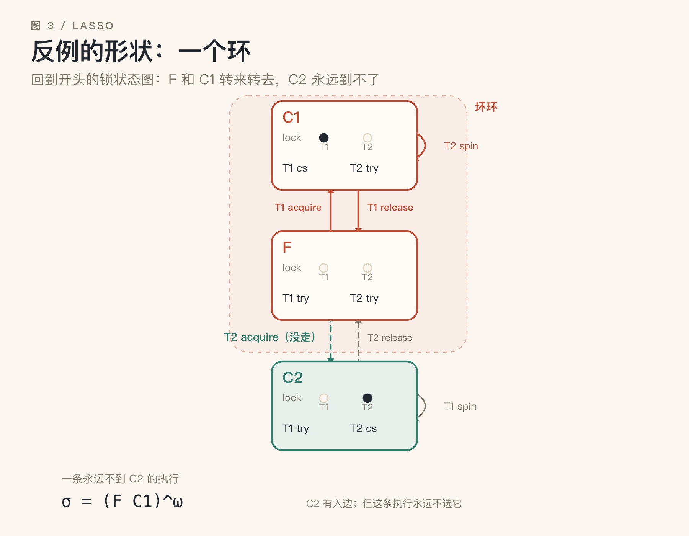
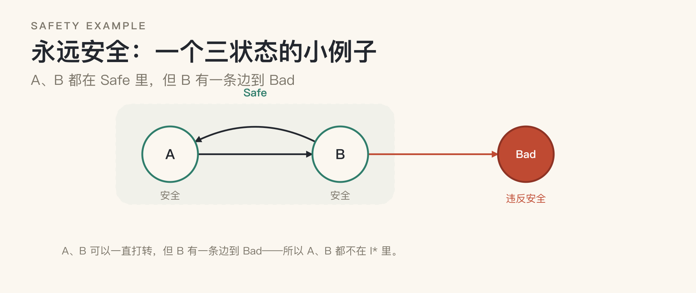
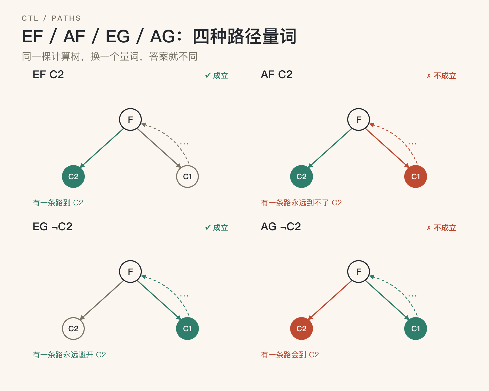
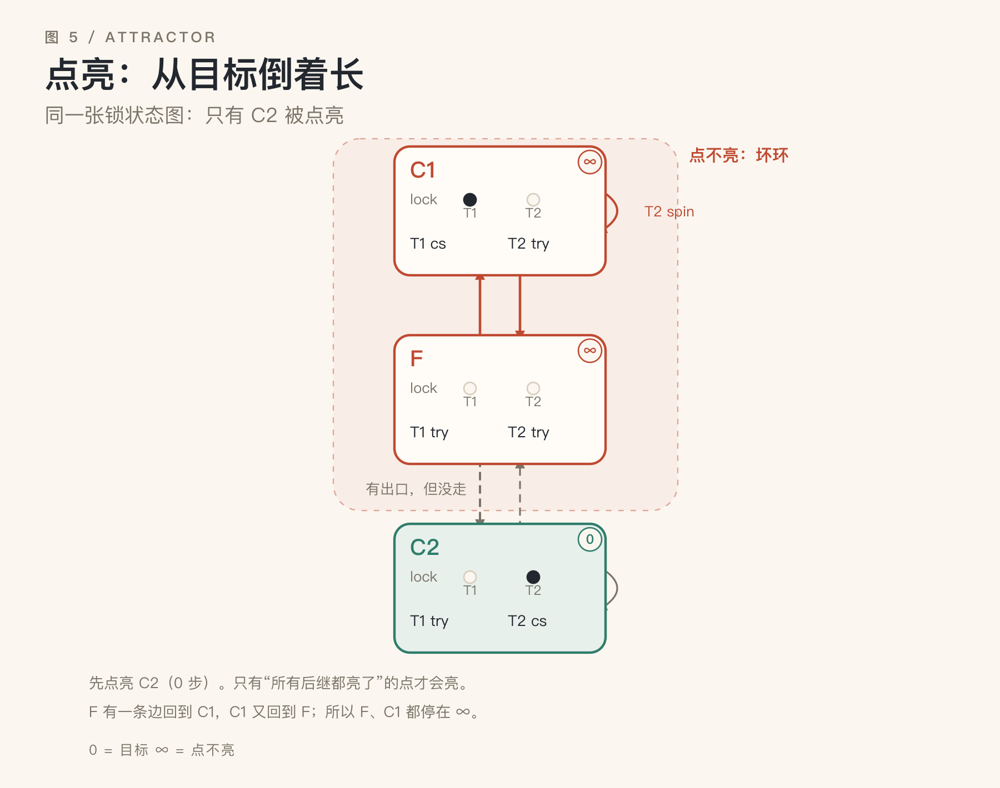

# 永远不报错的 Bug

*程序验证里的 liveness 与不动点：从“最终”到方程*

> 写给不熟悉形式化验证的软件工程师。\
> 不需要预备知识。

先看一个很小、但很典型的并发故障。

两个线程，T1 和 T2，抢同一把 test-and-set 自旋锁。调度器总是先运行 T1；T1 释放锁之后，又立刻把锁抢了回来。T2 一直在 `while (!acquired) yield();` 里打转。日志里没有异常，CPU 占用正常，T1 的活干得很好。唯一的症状是：T2 负责的那部分任务，永远不会开始。

你很难说清“哪一行代码错了”。T2 的等待逻辑是对的，锁的互斥也没问题；它们只是组合出了一条“T2 永远轮不到”的执行路径。

压测跑了十万次，T2 每次都拿到了锁——因为测试环境的调度恰好足够公平。线上那台机器上，T1 的循环总是快半拍，T2 就一直没被选中。这不是“T2 太慢”：再给它多少时间，它都不会被选中。这也不是死锁：T2 没有被卡住，它一直在运行——只是永远抢不到。

为了把状态图限制在三个状态，下面的模型省略了线程的 idle：假设两个线程都在循环里不断请求锁，只区分 try（自旋）和 cs（临界区）。



*小图：锁的状态图。每个状态标出 `lock`、T1、T2 的取值；实心点 = 持有，空心 = 空闲；try = 自旋，cs = 临界区。F 是锁空闲、两个线程都在 try；C1 是 T1 在临界区；C2 是 T2 在临界区。*

图里画出了这三个状态之间的全部迁移：F↔C1、F↔C2，以及 C1/C2 上的两个自旋自环。

这类问题有一个名字：**liveness（活性）的违反**。它不是“坏事发生了”，而是“好事一直没发生”。它不留下崩溃日志，只留下一个“看起来还在跑、但某部分永远没动静”的系统。

同样的形状也出现在分布式系统里：心跳永远收不到、选主永远选不出来、事务永远停在“准备提交”。它们都不是“算错了”，而是“永远走不到下一步”。

## 一、两种 Bug：崩溃，与永远不完成

Leslie Lamport 有一句著名的概括：

> Safety：nothing bad happens.
>
> Liveness：something good eventually happens.

safety 是“坏事永不发生”，liveness 是“好事终会发生”。这两句话听起来像废话，但它们精确地划出了两种完全不同的 bug。

| | Safety（安全） | Liveness（活性） |
|---|---|---|
| 一句话 | 坏事永不发生 | 好事终会发生 |
| 反例 | 有限的前缀 | 无限的轨迹 |
| 你看到的 | 崩溃、断言、越界 | 卡住、饿死、永远重试 |
| 典型性质 | 互斥、余额非负、不丢数据 | 终止、送达、最终响应 |
| 测试体验 | 通常能复现 | 常常“偶发”或“线上才有” |

这张表最重要的一行是“反例”。

safety 的违反总能在有限步内被逮住：数组越界的那一刻、断言失败的那一行、两个线程同时进入临界区的那一次。你把它打印出来，就是证据。

liveness 的违反没有这样的现场。你看到的每一个瞬间，都只是“还没发生”。系统没有做错任何一步，它只是永远走不到终点。

这不是说 liveness 比 safety 更严重，而是说它们的**证据形状**不同。形状不同，找它们的方法就不同。



*图 1：safety 的违反有一段有限的前缀作证据；liveness 的违反只有无限长的轨迹才能作为证据。*

## 二、把“最终”画出来

在讨论测试之前，先把“最终”这个词说清楚。

把一次运行画成一条时间线：s₀, s₁, s₂, … 每个点是一个时刻。设 p 是一个状态断言，比如“T2 拿到锁”。那么：

- **◇p（最终 p）**：存在某个时刻 p 成立。只要发生过一次，后面怎么样都行。
- **□p（永远 p）**：所有时刻 p 都成立。一次都不能少。
- **□◇p（无限多次 p）**：p 出现无限多次。它不是“一直”，而是“反复”；中间可以断。
- **◇□p（最终永远 p）**：从某一刻起，p 永远成立。它允许前面失败，但要求最终稳定。

这套“沿时间线看性质”的语言，叫**时序逻辑**（temporal logic）。上面四个记号，就是它最常用的四个词。



*图 2：同样是“p 会发生”，四种时间模式完全不同：一次、一直、反复发生、最终稳定。*

这四种模式，是后面所有讨论的词汇表。特别注意后两个：

- “每个请求最终都会被响应”是 **□◇**：请求源源不断，所以响应会一次又一次地出现；它不是“每一刻都恰好有一个响应”，而是“响应不会停”。
- “系统最终稳定下来”是 **◇□**：前面可以抖动，之后不再变。
- 对 T2 来说，**◇(T2 拿到锁)** 是“最终拿到一次”；**□◇(T2 拿到锁)** 是“反复拿到”；**◇□(T2 拿到锁)** 是“从某一刻起一直持有锁”。

其中 **◇p**、**□◇p**、**◇□p** 都是 liveness 性质；**□p** 是 safety 性质。它们都不是“某一步算错了”，而是“整条时间线上的模式不对”。

## 三、为什么测试抓不到“永远”

现在回到测试。把这条时间线正式地看成一条无限长的状态序列：

```text
σ = s₀, s₁, s₂, …
```

一条无限序列是一次完整的运行。一个性质 P 是一条规则：每条运行要么满足它，要么不满足。把所有满足 P 的运行收集起来，就得到一个集合；下面我们干脆用这个集合来代表 P。

**Safety**：如果 σ 违反 P，那么存在一个有限前缀，使得无论后面接什么，都已经违反 P。

**Liveness**：对任何有限前缀，都存在一种延续方式，使得整条序列满足 P。

safety 的违反是“不可挽回”的：坏事一旦发生，后面再补救也没用。liveness 的违反是“永远还可以再等等”的：无论你已经看了多久，都还存在“接下来会好”的可能。

后者有一个反直觉的推论：**没有任何有限观察能否定一个纯粹的 liveness 性质**。换成时间线的话，一张有限长度的截图，永远不能证明“后面不会出现 p”；它只能证明“到现在为止还没出现”。你看了 1 秒、1 年、10 亿步，都是如此。要否定“最终会发生”，你必须把整条无限轨迹看完。

> **冷知识**：1985 年，Alpern 和 Schneider 用拓扑学给这两种性质画了像：在无限轨迹的空间里，safety 是闭集（一旦违反，就再也回不到“没违反”），liveness 是稠密集（任何一个有限前缀，都能被延伸进这个集合）。他们还证明了一件更漂亮的事：任何性质都可以写成一个 safety 性质和一个 liveness 性质的交集。所以安全和活性不是互斥的两类，而是从两个角度描述同一个性质。

工程上有一个常用的办法：加 deadline。

“最终会完成”变成“30 秒内完成”。后者是一个 safety 性质——如果 30 秒到了还没完成，你已经拿到了一个有限的反例。这就是为什么监控系统热爱超时：它把不可观测的“永远”，换成了可观测的“到现在为止”。

但别骗自己：你监控的是“30 秒内”，不是“最终”。两者之间隔着的，正是 liveness 的全部难点。


## 四、反例的形状：一个绕不出去的环

既然纯 liveness 的反例必须是无限长的，它能不能被写下来？

在有限状态系统里，可以。

想象一只蚂蚁在一个有限的状态图里走。它有无穷多步要走，但只有有限个落脚点。根据鸽巢原理，某个状态一定会被重复访问。把“第一次访问它”到“第二次访问它”之间的那段路剪下来，你就得到了一个环。

如果这只蚂蚁走的整条路都没有遇到那件好事，那么这个环里也没有好事。于是，你可以让它从这个环的起点开始，一圈一圈地永远走下去——每走一圈，都回到同一个地方，那件好事仍然不会发生。

这样，一条无限长的坏轨迹，就被压缩成了“一段有限的前缀 + 一个无限重复的环”：

```text
σ = s₀ s₁ (s₂ s₃ s₄)^ω
```

这里的 `ω` 表示“把括号里的东西无限重复”。这就是**套索（lasso）**：一段有限的前缀，加一个无限循环的环。它是“无限”在有限世界里的可打印形式。

一个 liveness 反例，就是一个**可达的坏环**：从初始状态能走到这个环，而环里永远不会发生那件好事。

把开头的锁例子画成状态图，就是图 3：C1 是“T1 在临界区、T2 在 try”，F 是“锁空闲、两个线程都在 try”，C2 是“T2 在临界区、T1 在 try”。

F→C1 是 T1 抢到，C1→F 是 T1 释放；C1 上还有一个 T2 spin 的自环。F→C2 是 T2 抢到，C2→F 是 T2 释放；C2 上还有一个 T1 spin 的自环。F↔C1 组成一个环，F→C2 是环的出口——但这条执行永远不选它。

所以这条执行就是 `(F C1)^ω`：F→C1→F→C1……永远到不了 C2。这个例子里，起点 F 本身就在环上，所以前缀是空的。

死锁是一个退化的环：没有下一步，也可以看成永远停在原地。活锁是一个真实的环：一直在动，但没有进展。饥饿也是一个环：某个线程永远轮不到。

这也解释了模型检查器怎么找 liveness bug：它不需要模拟无限步，只需要找一个从初始状态可达、并且完全避开“好事”的环。这个环一定落在某个强连通分量（SCC）里；所以工具的实际做法是找 SCC，再在里面找环。

找环，就是找反例。

注意这个环的一个性质：从环里任意一点出发，下一步还在环里。也就是说，环对转移是封闭的。封闭的集合，正是“不动点”要捕捉的东西——你把它往前推一步，它还是它自己。



*图 3：把开头的锁例子画成状态图。F→C1 是 T1 抢到，C1→F 是 T1 释放；F→C2 是 T2 抢到，但这条执行永远不选它。于是 F 和 C1 转成 `(F C1)^ω`，永远到不了 C2。*

## 五、把“永远”写成方程

先忘掉 liveness，看一个更简单的问题：从起点出发，哪些状态是可达的？

如果 s 走一步能到达 s'，我们就说 s' 是 s 的一个**后继**。

（下面用到的 **∪** 和 **∩** 分别是并集和交集：前者把两个集合合起来，后者取两个集合共同的部分。）

把所有“从 s₀ 出发、经过有限步真的能走到”的状态收集起来，记作 **R\***。这就是可达集。

R* 有一个很自然的性质：它包含起点 s₀；并且，只要 s 在 R* 里，s 的每一个后继也都在 R* 里。用方程写就是：

```text
R* = {s₀} ∪ { s' | 存在 s ∈ R*，s → s' }
```

但这个方程有很多解。把整个状态空间 S 代进去，也满足方程——因为 S 包含起点，而且任何状态的后继当然还在 S 里。任何包含 R*、并且把每个状态的后继也包含进来的集合，都满足方程。

所以，光看方程不够；我们想要的是“最小”的那个解，而 R* 恰好就是最小解。为什么要最小？因为方程只说“包含起点、把后继也包含进来”，它没有说“不能多算”。如果你取一个大集合，就会把根本走不到的状态也算成“可达”，结论就不准了。最小解恰好是“一个不多、一个不少”的可达集。

怎么求最小解？从空集开始迭代：

```text
X₀ = ∅
X₁ = {s₀}
X₂ = X₁ ∪ { s' | 存在 s ∈ X₁，s → s' }
…
```

因为状态有限，最多迭代 |S|+1 轮，这个序列就停了。停下来的 Xₙ 就是 R*，也就是**最小不动点**（least fixed point），记作 μ。

再看“永远安全”。

先定义 **Safe**：所有满足安全性质的状态。比如锁的例子，Safe 是“互斥没有被破坏”的所有状态；**Bad** 是“两个线程同时持锁”的状态。

注意，Safe 不一定是整个状态空间 S；只有当 S 里根本没有 Bad 状态时，Safe 才等于 S。否则它只是 S 的一部分。

再定义 **I\***：从 I* 里的任何状态出发，无论系统怎么走，都永远不会离开 Safe。I* 是 Safe 的子集，通常还会更小。

这里要小心：一个状态不在 I* 里，不一定是因为它自己违反了安全。它可能自己很安全，只是有一条路能走到 Bad。它和 S 的其他部分完全可能连通——只是连通的另一端是 Bad。

I* 满足：

```text
I* = Safe ∩ { s | s 的所有后继都在 I* 里 }
```

这句话读作：s 在 I* 里，当且仅当

1. s 自己在 Safe 里；
2. s 的每一个后继都在 I* 里。

注意这是一个递归的定义：I* 出现在它自己的右边。它不是“先有 I*，再算右边”，而是一个方程，我们要找满足它的集合。

（这里假设每个状态都有后继；死锁可以看成一个原地打转的自环。）

举个小例子（见下面的小图）。假设状态图只有三个状态：A、B、Bad。A → B，B → A，B → Bad。Safe = {A, B}。



*小图：Safe 只要求“现在满足安全性质”；I* 还要求“以后也走不到 Bad”。B 有一条边到 Bad，所以 A、B 都不在 I* 里。*

- 从 A 出发，可以走 A → B → Bad，所以 A 不在 I* 里；
- 从 B 出发，也可以 B → Bad，所以 B 也不在 I* 里。

于是 I* 是空集：没有任何状态能保证“永远不碰到 Bad”。

如果把 B → Bad 这条边删掉，A 和 B 就都在 I* 里了：从 A 或 B 出发，无论怎么走，都只在 A、B 之间打转，碰不到 Bad。

这也解释了为什么要“最大”。空集也满足方程（它当然永远不会离开 Safe），但那样什么状态都不敢保证。最大解是“能一直安全走下去”的最大区域；它不会漏掉本来安全的状态。

从全集开始，反复把“已经违反 Safe”或“有一个后继不在 I* 里”的状态删掉。删到不动为止，剩下的就是**最大不动点**（greatest fixed point），记作 ν。

现在把刚才的两个方程写成函数：

- 可达性：`f(X) = {s₀} ∪ post(X)`，其中 `post(X)` 是“X 里所有状态的一步后继”。
- 永远安全：`g(Y) = Safe ∩ preAll(Y)`，其中 `preAll(Y)` 是“所有后继都在 Y 里的状态”。

于是，前面的两个方程就是 `R* = f(R*)` 和 `I* = g(I*)`。迭代就是反复调用这两个函数：

```text
X₀ = ∅      X₁ = f(X₀)      X₂ = f(X₁)      …
Y₀ = S      Y₁ = g(Y₀)      Y₂ = g(Y₁)      …
```

这两个函数有一个共同点：**单调**。如果 X ⊆ Y，那么 f(X) ⊆ f(Y)，g(X) ⊆ g(Y)——你给它的集合越大，它返回的集合也越大。单调性保证从空集往上迭代时不会来回跳，从全集往下迭代时也不会。

把这件事再抽象一步：任何一个单调函数 f，只要定义域是“状态集合”这个有限格，就一定有最小不动点和最大不动点。从空集往上迭代得到最小不动点，从全集往下迭代得到最大不动点。这就是 Knaster–Tarski 定理在有限格上的计算版本（格，你可以理解成“集合按包含关系排成的层级”）。有限性保证迭代一定会停。

> 方程只描述“一步”，解却描述“所有步”。不动点，就是把“一步”和“永远”接起来的那座桥。


*图 4：最小不动点从空集往上长，最大不动点从全集往下剥。两者都在有限步内停，停下来的地方就是方程的解。*

## 六、两个不动点，两种“永远”

把 μ 和 ν 放在一起看，它们的性格完全不同：

| | 最小不动点 μ | 最大不动点 ν |
|---|---|---|
| 起点 | ∅ | S |
| 直觉 | 最少承诺：只算真的能到的 | 最大容忍：只要还没出事就留着 |
| 回答 | 能不能到达？ | 能不能永远保持？ |
| 证据 | 有限步的路径 | 不变式 |
| 典型 | 可达、终止、最终 | 安全、互斥、不变 |

前面已经认识了 **◇p**（最终）、**□p**（永远）、**□◇p**（无限多次）、**◇□p**（最终永远）。现在把它们写成方程。

先看一条固定的时间线。下一步只有一个，所以“最终 p”可以写成：

```text
◇p = μX. p ∨ ○X
```

这里的 `○X` 读作“下一步 X 成立”；X 是方程里的未知数，代表“p 最终成立”。这条方程读作：p 最终成立，等价于“p 现在成立，或者下一步之后最终成立”。这是最小不动点：最小的解，就是“存在某个有限时刻 p 成立”。

这和前面的 `f(X) = {s₀} ∪ post(X)` 是同一个形状：一个“现在就能成立”的基准（p 或 {s₀}），加上“再走一步”的部分（○X 或 post(X)）。区别只是：f 从起点往前走，而这里沿着时间线往后看。

同理，“永远 p”可以写成：

```text
□p = νX. p ∧ ○X
```

这里的 X 代表“p 永远成立”。它读作：p 现在成立，并且下一步之后也永远成立。这是最大不动点：最大的解，就是“所有时刻 p 都成立”。

它们互为对偶：

```text
¬◇p = □¬p
¬□p = ◇¬p
```

“最终会好”的否定是“永远不好”；“永远安全”的否定是“最终会坏”。对 T2 来说，“最终拿到锁”的否定，就是“永远拿不到锁”。你没法只定义其中一个而不定义另一个。

如果你把“一条固定的时间线”换成“一个状态图，每个状态可能有多个后继”，`◇` 和 `□` 就要区分“存在一条路径”和“所有路径”。下面这段就是干这个的，稍微绕一点；如果你只想看算法，可以跳到第七节。

在往下读之前，先记住四个简写：**E** = 存在一条路径，**A** = 所有路径，**F** = finally（最终），**G** = globally（永远）。

> **一个容易绕晕的地方**：既然 liveness 是“最终”，它到底是 μ 还是 ν？
>
> 答案是：看你说的是“好”还是“坏”。
>
> - “存在一条路径最终到达 p”（`EF p`）是 μ：证据是一条有限路径。
> - “所有路径最终到达 p”（`AF p`）也是 μ，只是把“存在后继”换成了“所有后继”。
> - 但“存在一条路径永远不到 p”（`EG ¬p`）是 ν：证据是一个环。
> - 所以“所有路径最终到达 p” = `¬EG ¬p`：好集合是 μ，坏集合是 ν，它们是补集。
>
> 很多文章说“liveness 是最小不动点”，这句话对，但省略了“好集合”三个字。真正重要的是：你是在从目标往外点亮，还是在从全集往里剥。两种算法算的是同一个答案。



*小图：同一棵计算树上的四种路径量词。EF C2 只要有一条路到 C2；AF C2 要求所有路都到 C2，C1↔F 的环让它不成立；EG ¬C2 存在一条路永远避开 C2；AG ¬C2 要求所有路都避开 C2，F→C2 这条路让它不成立。*

这三种记号经常混着用，但它们看的东西不同：

| 语言 | 看什么 | 文中记号 | 用在哪 |
|---|---|---|---|
| LTL | 一条时间线 | ◇、□、□◇、◇□ | 第二节、公平性 |
| CTL | 一棵计算树（有分支） | EF、AF、EG、AG | 这一节、算法 |
| μ-calculus | 方程/不动点 | μX、νX | 第五节、这一节 |

它们不是三套互斥的记号，而是三种视角：LTL 看一条运行，CTL 看一棵计算树，μ-calculus 看方程。CTL 和 LTL 都可以翻译成 μ-calculus；CTL* 则把路径量词和时序操作符自由组合。本文用到哪一副眼镜，就在哪一段说清楚。

## 七、点亮：从目标倒着长

现在回到最初的问题：怎样证明“所有路径最终都会到达目标”？把开头的锁例子画成状态图（图 5）：C1 是“T1 在临界区、T2 在 try”，F 是“锁空闲、两个线程都在 try”，C2 是“T2 在临界区、T1 在 try”。目标就是 C2。

有一个非常朴素的算法。先把 Goal 点亮；然后看哪些状态，它们的每一个后继都已经被点亮——这些状态也点亮；重复这个过程，直到没有新的状态被点亮。

用伪代码写：

```text
X := Goal
repeat
  X := X ∪ { s | s 有后继，且 s 的所有后继都在 X 中 }
until X 不再变化
```

在这个例子里：

- C2 是目标，第 0 轮点亮（0 步到 C2）。
- F 的后继有 C1 和 C2。C1 还没亮，所以 F 不能亮。
- C1 的后继有 F（还有 T2 spin 的自环）。F 没亮，所以 C1 也不能亮。

于是只有 C2 亮着；F 和 C1 留在坏环里，点不亮。

C2 一旦到达，目标就满足了；它之后释放锁回到 F，不影响“最终到达 C2”。算法把 Goal 直接点亮，不再检查它的后继。

更一般地，每一轮点亮的点，都比上一轮离 Goal 更远一步。第 k 轮点亮的点，有一个非常实际的解释：从它出发，无论你怎么走，最多 k 步就会到达 Goal。对 k 归纳一下就能看出来。这个“最多 k 步”，就是一个**排名函数**（ranking function），也是一张 liveness 的证书。

那些始终点不亮的点呢？它们每一个都至少有一个后继也点不亮。于是你可以从任何一个点不亮的点出发，永远沿着“点不亮的后继”走下去——你得到了一条无限路径，它永远不到 Goal。因为状态有限，这条路径最终一定会绕进一个环。这个环，就是第四节里的套索。

所以，这个算法同时给出了两样东西：如果起点被点亮，你得到一张“最多 k 步”的证明；如果起点没被点亮，你得到一条通往坏环的反例。

证明和反例，是同一个迭代的两面。

这里的关键词是“所有后继”。在锁例子里，F 同时有一条边到 C2（好）和一条边到 C1（坏）；因为算法要求“所有后继”都亮，F 不能亮。这就是“存在一条成功路径”和“所有路径都成功”的区别。

如果你只要求“存在一条路能到 Goal”，那只要普通的图搜索就够了：找到一条路，就交差。但工程上我们关心的通常是“无论调度怎么选，最终都会到”。

这两件事的区别，说穿了就是“存在”和“所有”：前者只要找到一条成功的路，后者要求每一条路都成功。“有一条路能成功”和“每一条路都能成功”，是两种完全不同的保证。

这个算法处理的是“最终到达”（eventually）。如果好事是“无限多次发生”（比如“每个请求最终都会被响应”，而请求源源不断），那就不能只看“能不能到达”，而要看“能不能永远躲开”。这时算法从“点亮”变成“找强连通分量”：如果存在一个从起点可达的环，环里一次好事都没有，那就是反例。模型检查器里的 Büchi 自动机、SCC 算法，做的就是这件事。

> **深水区**：完整的线性时序逻辑（LTL）模型检查复杂度很高（PSPACE 完全）：公式要先变成自动机，规模可能指数爆炸；但落到图上的核心动作，仍然是迭代、取前驱、找环。



*图 5：同一张锁状态图。只有 C2 被点亮；F、C1 可以一直在彼此之间打转，永远到不了 C2，所以点不亮。*

## 八、公平性：liveness 的隐形前提

现在你可能会觉得：只要把状态图写出来，点亮算法一跑，liveness 就解决了。可惜还有一个躲不开的问题：调度器。

还记得开头那两个线程吗？如果调度器总是偏袒 T1，让 T1 一次次把锁抢回去，那么“T2 最终会拿到锁”就是假的。但 T2 的等待逻辑完全正确：它只是没被选中。

这不是 T2 的 bug，也不是锁的 bug，而是“程序 + 调度器”这个联合系统的 bug。

所以 liveness 从来不是孤立的程序性质。你证明的永远是一个条件命题：**在公平的调度下，最终……**

要证明它，你必须对调度器做一个公平性假设：

- **弱公平（weak fairness）**：如果一个动作从某一刻起一直 enabled，那么它最终会被执行（而且是无限多次）。
- **强公平（strong fairness）**：如果一个动作无限多次 enabled，那么它无限多次被执行。

用 TLA+ 的话说，规格里通常写 `WF_vars(Next)`，意思是“不会永远忽略一个持续可执行的动作”。没有这个假设，几乎任何 liveness 都可以被一个恶意的调度器破坏。

公平性本身也是用 liveness 的语言写的（**□◇** 读作“无限多次”，**◇□** 读作“最终永远”），这看起来像循环论证：用一个 liveness 假设去证明另一个 liveness。但它不是循环——公平性是对环境的假设，不是对程序的结论。你证明的是一个条件命题：在公平的调度下，程序最终会进展。这个“在……下”不能省。

这也是分布式系统里一个著名结论的日常版本：FLP 的结论是，在一个完全异步、允许一个进程崩溃的系统里，确定性共识协议可以保证一致性（不会有两个节点决定不同的值），但无法保证终止（每个节点最终都会做出决定）。换句话说，它不是“会算错”，而是“可能永远算不完”。工程上的对策不是“更努力地证明”，而是加时间假设：超时、心跳、部分同步。用时间换 liveness，这是分布式系统最熟悉的权衡。

公平性假设太强，会掩盖真正的饥饿 bug；太弱，又证不出东西。所以写规格时，最好把假设显式写出来：“在假设 F 下，最终 P”。如果你说不出 F 是什么，你拥有的不是定理，只是希望。


*图 6：不公平的调度可以让“最终”永远不到来。公平性不是代码的属性，而是代码与环境的联合假设。*

## 九、你早就在写不动点了

如果你觉得这些东西离日常很远，看看下面几个东西。

**Kubernetes 的 reconcile。** 控制器里最核心的循环叫 reconcile：观察实际状态，算出期望状态，执行动作，再观察。把它写成函数，就是 `actual' = f(actual)`。当 `actual = f(actual)` 时，集群收敛了——这就是一个不动点。

控制器抖动、反复创建删除、永远不收敛，本质上是在一个没有不动点（或掉进了极限环）的迭代里打转。“最终收敛”是一个 liveness 性质；“永远不违反策略”是一个 safety 性质。Kubernetes 的整个声明式模型，就是建立在这两种性质上的。

**CRDT。** 状态型 CRDT 的 merge 是幂等、交换、结合的。无论副本以什么顺序合并，最终都会到达所有更新的最小上界——一个 merge 的不动点：`merge(x, x) = x`。“最终一致”里的“最终”，正是一个 liveness 承诺；而“不会丢掉已发生的更新”，是一个 safety 承诺。

**编译器的数据流分析。** 到达定值（reaching definitions）分析，是在求一个最小不动点；可用表达式（available expressions）分析，是在求一个最大不动点。你每天看到的“变量未使用”“这段代码不可达”，背后都是某个方程的解。格的高度决定了迭代最多跑几轮。

**超时、重试与排名函数。** 你写的每一个 `while (!done) retry()`，都在许诺一个 liveness；你加的每一个 deadline，都是在把它换成一个 safety。下面这个循环里，`N - attempt` 就是一个排名函数：

```python
attempt = 0
while not done and attempt < N:
    attempt += 1
    done = try_once()
```

它严格下降，且有下界 0，所以循环一定终止。没有这个排名函数，“最终”就只是一个愿望。

**React 的更新循环。** 你大概见过 `Maximum update depth exceeded`——它是在说：这个更新循环没有收敛。一个在 A、B 两个状态之间来回跳的组件，就是一个长度为 2 的环，一个活锁。

## 十、带走一张地图

把“有限还是永远”和“存在还是所有”放在一起，会得到一张很好用的地图：

| | E：存在一条路径 | A：所有路径 |
|---|---|---|
| μ：有限步 | `EF p`：能到达 p | `AF p`：必然到达 p |
| ν：永远 | `EG q`：存在一条路永远 q | `AG q`：永远 q |

- “请求最终会被响应”：通常是 `AF`（所有路径最终响应），而且往往还要加上公平性假设。
- “不会死锁”：`AG`（永远不进入死锁）。
- “能重试成功”：`EF`（存在一条成功路径）。注意，这比 `AF` 弱得多。
- “永远不丢数据”：`AG`。

很多线上事故，源于把 `AF` 写成了 `EF`：代码能成功，但系统不保证成功。

如果你只想带走五句话：

1. safety 的违反有有限证据；纯 liveness 的违反只有无限证据。测试天生更擅长前者。
2. 有限状态系统里，无限反例总能写成一个环。找 liveness bug，就是找可达的坏环。
3. “最终”是最小不动点，“永远”是最大不动点；它们互为对偶。
4. 证明 liveness 的实用形式是一个排名函数：最多等多久。找不到排名，就去找环。
5. 工程上的 liveness 几乎都有隐藏的公平性假设。写不出假设，就等于没证明。

## 尾声：永远的形状

回到开头那两个线程。T2 的等待逻辑没有错，锁的互斥也没有问题；它们只是组合出了一条“永远轮不到”的路径。安全性能告诉你“没有哪一步越界”；只有 liveness 能告诉你“这条路真的会到”。

“永远”不是一段很长的时间，而是一个方程的解。安全是“永不越界”的不动点，活性是“终会抵达”的不动点；一个从下往上建，一个从上往下剥。人类看不见无限，但可以解方程。

下次再遇到那种“它就是不工作，但也不报错”的 bug，别只加日志。画出状态图，找到那个环。

那个环，就是“永远”的形状；而你要做的，是在环里开一个出口。

---

### 延伸阅读

- Leslie Lamport, *Specifying Systems*（TLA+ 与规约的经典教材）
- Christel Baier, Joost-Pieter Katoen, *Principles of Model Checking*（liveness、Büchi 自动机与 SCC 的标准参考）
- Bowen Alpern, Fred B. Schneider, “Defining Liveness”, *Information Processing Letters*, 1985
- Michael J. Fischer, Nancy A. Lynch, Michael S. Paterson, “Impossibility of Distributed Consensus with One Faulty Process”, 1985
- Dexter Kozen, “Results on the Propositional μ-Calculus”, 1983
