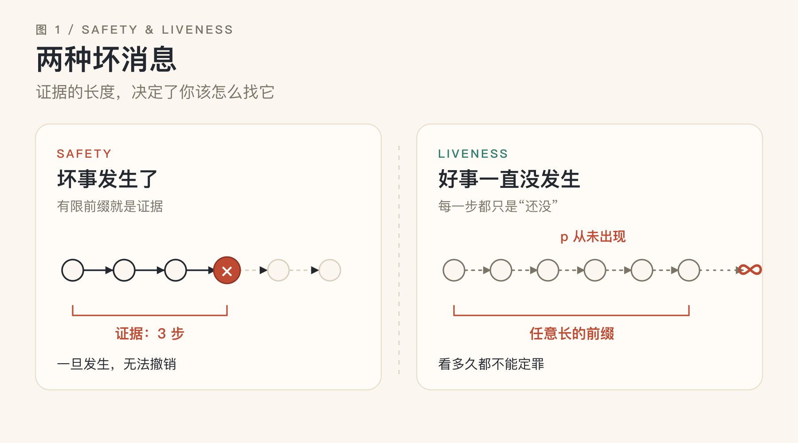
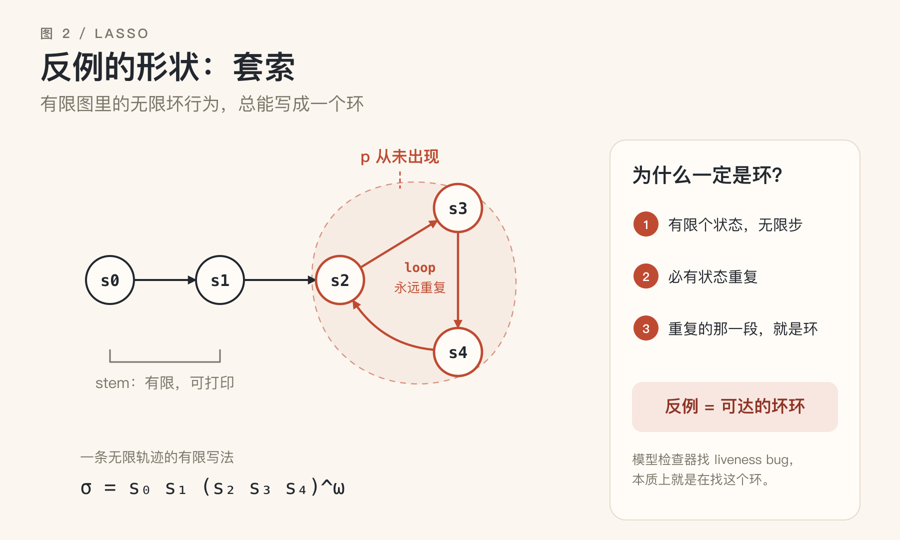
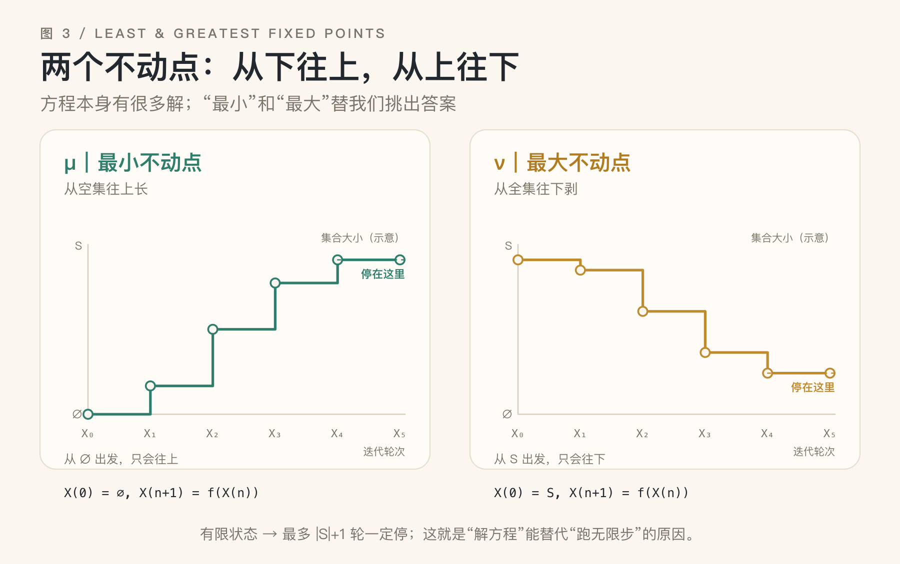

# 永远，是一个不动点

*从“永远不会发生的 bug”说起：liveness、无限轨迹与方程*

> 写给不熟悉形式化验证的软件工程师。\
> 不需要预备知识，只需要写过几行会“卡住”的代码。

先讲一个虚构的故障，但它大概率和你见过的某个 bug 长得很像。

支付回调成功了，消息也进了队列。日志里每隔几秒出现一行 `retry scheduled`，没有异常，没有崩溃，CPU 和内存都稳得像一条直线。唯一的症状是：订单永远停在“处理中”。

测试跑了十万次，一次都没复现。不是运气不好——每次测试只观察 30 秒，而这个 bug 的全部内容，是“第 31 秒之后也不会发生”。

你没法用一段有限长度的观察，去证明一件永远不会发生的事。

这类 bug 有一个名字：**liveness（活性）的违反**。它不是“坏事发生了”，而是“好事一直没发生”。它不留下崩溃日志，只留下一个安静地停在那里的系统。

## 一、坏消息有两种

Leslie Lamport 有一句著名的概括：

> Safety：nothing bad happens.
>
> Liveness：something good eventually happens.

safety 是“坏事永不发生”，liveness 是“好事终会发生”。这两句话听起来像废话，但它们精确地划出了两种完全不同的 bug。

| | Safety（安全） | Liveness（活性） |
|---|---|---|
| 一句话 | 坏事永不发生 | 好事终会发生 |
| 反例 | 有限的前缀 | 无限的轨迹 |
| 你看到的 | 崩溃、断言、越界 | 卡住、饿死、永远重试 |
| 典型性质 | 互斥、余额非负、不丢数据 | 终止、送达、最终响应 |
| 测试体验 | 通常能复现 | 常常“偶发”或“线上才有” |

这张表最重要的一行是“反例”。

safety 的违反有一个有限的最早现场：数组越界的那一刻、断言失败的那一行、两个线程同时进入临界区的那一次。你把它打印出来，就是证据。

liveness 的违反没有这样的现场。你看到的每一个瞬间，都只是“还没发生”。系统没有做错任何一步，它只是永远走不到终点。

这不是说 liveness 比 safety 更严重，而是说它们的**证据形状**不同。形状不同，找它们的方法就不同。

## 二、为什么测试抓不到“永远”

把系统的一次完整运行看成一条无限长的状态序列：

```text
σ = s₀, s₁, s₂, …
```

一个性质 P，就是这些无限序列的集合。

**Safety**：如果 σ 违反 P，那么存在一个有限前缀，使得无论后面接什么，都已经违反 P。

**Liveness**：对任何有限前缀，都存在一种延续方式，使得整条序列满足 P。

（liveness 是一个很宽的类：`◇p`、`□◇p`、`◇□p` 都算。它们的共同点是：没有任何有限前缀能单独否定它。）

safety 的违反是“不可挽回”的：坏事一旦发生，后面再补救也没用。liveness 的违反是“永远还可以再等等”的：无论你已经看了多久，都还存在“接下来会好”的可能。

后者有一个反直觉的推论：**没有任何有限观察能否定一个纯粹的 liveness 性质**。你看了 1 秒、1 年、10 亿步，都只证明了一件事——“到现在为止还没发生”。要否定“最终会发生”，你必须把整条无限轨迹看完。

> **冷知识**：1985 年，Alpern 和 Schneider 用拓扑学给这两种性质画了像：在无限轨迹的空间里，safety 是闭集，liveness 是稠密集（任何一个有限前缀，都能被延伸进这个集合）。他们还证明了一件更漂亮的事：任何性质都可以写成一个 safety 性质和一个 liveness 性质的交集。所以安全和活性不是互斥的两类，而是观察同一个性质的两束光。

工程上有一个常用的逃逸办法：加 deadline。

“最终会完成”变成“30 秒内完成”。后者是一个 safety 性质——如果 30 秒到了还没完成，你已经拿到了一个有限的反例。这就是为什么监控系统热爱超时：它把不可观测的“永远”，换成了可观测的“到现在为止”。

但别骗自己：你监控的是“30 秒内”，不是“最终”。两者之间隔着的，正是 liveness 的全部难点。



*图 1：safety 的违反有一段有限的前缀作证据；liveness 的违反只有无限长的轨迹才能作为证据。测试只能看到左边那种。*

## 三、反例的形状：鬼打墙

既然纯 liveness 的反例必须是无限长的，它能不能被写下来？

在有限状态系统里，可以。

想象一只蚂蚁在一个有限的状态图里走。它有无穷多步要走，但只有有限个落脚点。根据鸽巢原理，某个状态一定会被重复访问。把两次访问之间的那段路切下来，你就得到了一个环；如果整条路都避开那件好事，这个环也避开它。既然环里的每一步都还是坏消息，你就可以让它永远转下去。

于是，一条无限长的坏轨迹，可以被压缩成“一段有限的前缀 + 一个无限重复的环”：

```text
σ = s₀ s₁ (s₂ s₃ s₄)^ω
```

这就是**套索（lasso）**：一段有限的前缀，加一个无限循环的环。它是“无限”在有限世界里的可打印形式。

一个 liveness 反例，就是一个**可达的坏环**：从初始状态能走到这个环，而环里永远不会发生那件好事。

死锁是一个退化的环：没有下一步，也可以看成永远停在原地。活锁是一个真实的环：一直在动，但没有进展。饥饿也是一个环：某个线程永远轮不到。

这也解释了模型检查器怎么找 liveness bug：它不需要模拟无限步，只需要找一个从初始状态可达、并且完全避开“好事”的环。这个环一定落在某个强连通分量（SCC）里；所以工具的实际做法是找 SCC，再在里面找环。

找环，就是找反例。

注意这个环的一个性质：从环里任意一点出发，下一步还在环里。也就是说，环对转移是封闭的。封闭的集合，正是“不动点”要捕捉的东西——你把它往前推一步，它还是它自己。



*图 2：有限状态系统里的无限反例，总能写成“一段前缀 + 一个环”。环里没有“好事”，所以转多少圈都没用。*

## 四、把“永远”写成方程

先忘掉 liveness，看一个更简单的问题：从起点出发，哪些状态是可达的？

设 R 是可达状态的集合。它满足：

```text
R = {s₀} ∪ { s' | 存在 s ∈ R，s → s' }
```

这个方程说的是：R 包含起点；并且，R 里任何状态走一步到达的状态，也必须在 R 里。换句话说，R 对“走一步”封闭。

但这个方程有很多解。真正的可达集是一个解；把整个状态空间 S 代进去，也是一个解——因为 S 当然包含起点，也对一步封闭。我们想要的是“最小”的那个：它只包含真正能走到的状态，不凭空多算。

怎么求最小解？从空集开始，反复代入。第一轮放入起点；之后每一轮，把“再走一步能到达”的状态加进来：

```text
R₀ = ∅
R₁ = {s₀}
R₂ = R₁ ∪ { s' | 存在 s ∈ R₁，s → s' }
…
```

因为状态有限，最多迭代 |S|+1 轮，这个序列就停了。停下来的地方，就是**最小不动点**（least fixed point），记作 μ。

再看“永远安全”。设 I 是所有“从它出发，无论怎么走都不会违反安全”的状态。它满足：

```text
I = Safe ∩ { s | s 的所有后继都在 I 里 }
```

（这里假设每个状态都有后继；死锁可以看成一个原地打转的自环。）

同样，这个方程有很多解：空集是一个解（太悲观，什么都没保证），整个状态空间也可能是一个解（如果 Safe = S）。我们想要最大的那个：它尽可能多地把状态留在里面，只有当某一步真的可能出事时，才把状态踢出去。

从全集开始，反复把“已经违反 Safe”或“有一个后继不在 I 里”的状态删掉。删到不动为止，剩下的就是**最大不动点**（greatest fixed point），记作 ν。

把这两件事抽象出来：有一个单调函数 f，把状态集合映射成状态集合；我们找 X 满足 X = f(X)。从空集往上迭代，得到最小不动点；从全集往下迭代，得到最大不动点。这就是 Knaster–Tarski 不动点定理在有限格上的计算版本（格，你可以理解成“集合按包含关系排成的层级”）。单调性保证迭代不会来回跳；有限性保证它一定会停。

为什么单调？因为 f 是用“所有后继”“存在后继”这样的算子搭出来的：你给它的集合越大，它还给你的集合也越大。这个性质听起来很弱，但它是整个故事的地基。

> 方程只描述“一步”，解却描述“所有步”。不动点，就是把“一步”和“永远”接起来的那座桥。



*图 3：最小不动点从空集往上长，最大不动点从全集往下剥。两者都在有限步内停，停下来的地方就是方程的解。*

## 五、两个不动点，两种“永远”

把 μ 和 ν 放在一起看，它们的性格完全不同：

| | 最小不动点 μ | 最大不动点 ν |
|---|---|---|
| 起点 | ∅ | S |
| 直觉 | 最少承诺：只算真的能到的 | 最大容忍：只要还没出事就留着 |
| 回答 | 能不能到达？ | 能不能永远保持？ |
| 证据 | 有限步的路径、排名函数 | 不变式 |
| 典型 | 可达、终止、最终 | 安全、互斥、不变 |

用时序逻辑（temporal logic）写出来，会更清楚：

```text
◇p = μX. p ∨ ○X
□p = νX. p ∧ ○X
```

`○` 表示“下一步”。`◇p` 的意思是“存在某个时刻 p 成立”：要么现在成立，要么下一步之后某个时刻成立。这是一个最小不动点，因为它的证据是一个有限的时刻。`□p` 的意思是“永远成立”：现在成立，并且下一步之后也永远成立。这是一个最大不动点，因为它的证据是一个可以无限延续的不变式。

它们互为对偶：

```text
¬◇p = □¬p
¬□p = ◇¬p
```

“最终会好”的否定是“永远不好”；“永远安全”的否定是“最终会坏”。你没法只定义其中一个而不定义另一个。

下面这个盒子稍微绕一点，但它是全文最容易被误解的地方；如果你只想看算法，可以跳到第六节。

> **一个容易绕晕的地方**：既然 liveness 是“最终”，它到底是 μ 还是 ν？
>
> 答案是：看你说的是“好”还是“坏”。
>
> - “存在一条路径最终到达 p”（`EF p`）是 μ：证据是一条有限路径。
> - “所有路径最终到达 p”（`AF p`）也是 μ，只是把“存在后继”换成了“所有后继”。
> - 但“存在一条路径永远不到 p”（`EG ¬p`）是 ν：证据是一个环。
> - 所以“所有路径最终到达 p” = `¬EG ¬p`：好集合是 μ，坏集合是 ν，它们是补集。
>
> 很多文章说“liveness 是最小不动点”，这句话对，但省略了“好集合”三个字。真正重要的是：你是在从目标往外点亮，还是在从全集往里剥。两种算法算的是同一个答案。
>
> （E = 存在一条路径，A = 所有路径，F = finally，G = globally。）

## 六、点亮：从目标倒着长

现在回到最初的问题：怎样证明“所有路径最终都会到达 Goal”？

有一个非常朴素的算法。先把 Goal 点亮；然后看哪些状态，它们的每一个后继都已经被点亮——这些状态也点亮；重复这个过程，直到没有新的状态被点亮。

用伪代码写：

```text
X := Goal
repeat
  X := X ∪ { s | s 有后继，且 s 的所有后继都在 X 中 }
until X 不再变化
```

每一轮点亮的点，都比上一轮离 Goal 更远一步。第 k 轮点亮的点，有一个非常实际的解释：从它出发，无论你怎么走，最多 k 步就会到达 Goal。对 k 归纳一下就能看出来。这个“最多 k 步”，就是一个**排名函数**（ranking function），也是一张 liveness 的证书。

那些始终点不亮的点呢？它们每一个都至少有一个后继也点不亮。于是你可以从任何一个点不亮的点出发，永远沿着“点不亮的后继”走下去——你得到了一条无限路径，它永远不到 Goal。因为状态有限，这条路径最终一定会绕进一个环。这个环，就是第三节里的套索。

所以，这个算法同时给出了两样东西：如果起点被点亮，你得到一张“最多 k 步”的证明；如果起点没被点亮，你得到一条通往坏环的反例。

证明和反例，是同一个迭代的两面。

注意这里的关键词是“所有后继”。如果你只要求“存在一条路能到 Goal”，那只要普通的图搜索就够了：找到一条路，就交差。但工程上我们关心的通常是“无论调度怎么选，最终都会到”。

这两件事，差了整整一个量词。

“有一条路能成功”和“一定会成功”，是两种完全不同的人生。

这个算法处理的是“最终到达”（eventually）。如果好事是“无限多次发生”（比如“每个请求最终都会被响应”，而请求源源不断），那就不能只看“能不能到达”，而要看“能不能永远躲开”。这时算法从“点亮”变成“找强连通分量”：如果存在一个从起点可达的环，环里一次好事都没有，那就是反例。模型检查器里的 Büchi 自动机、SCC 算法，做的就是这件事。

> **深水区**：完整的线性时序逻辑（LTL）模型检查复杂度很高（PSPACE 完全）：公式要先变成自动机，规模可能指数爆炸；但落到图上的核心动作，仍然是迭代、取前驱、找环。


*图 4：从目标往外点亮：第 k 轮点亮的点，保证最多 k 步到达目标；点不亮的点，藏着一条永远不到目标的环。注意 S：它有一条好路，但一条坏路就足以让它点不亮。*

## 七、公平性：liveness 的隐形前提

现在你可能会觉得：只要把状态图写出来，点亮算法一跑，liveness 就解决了。可惜还有一个躲不开的问题：调度器。

想象两个线程，T1 拿着锁，T2 在等锁。如果调度器永远只运行 T1，那么“T2 最终会拿到锁”就是假的。但 T2 的等待逻辑完全正确：它只是没被选中。

这不是 T2 的 bug，也不是锁的 bug，而是“程序 + 调度器”这个联合系统的 bug。

所以 liveness 从来不是孤立的程序性质。你证明的永远是一个条件命题：**在公平的调度下，最终……**

要证明它，你必须对调度器做一个公平性假设：

- **弱公平（weak fairness）**：如果一个动作从某一刻起一直 enabled，那么它最终会被执行（而且是无限多次）。
- **强公平（strong fairness）**：如果一个动作无限多次 enabled，那么它无限多次被执行。

用 TLA+ 的话说，规格里通常写 `WF_vars(Next)`，意思是“不会永远忽略一个持续可执行的动作”。没有这个假设，几乎任何 liveness 都可以被一个恶意的调度器破坏。

公平性本身也是用 liveness 的语言写的（`□◇`、`◇□`），这看起来像循环论证：用一个 liveness 假设去证明另一个 liveness。但它不是循环——公平性是对环境的假设，不是对程序的结论。你证明的是一个条件命题：在公平的调度下，程序最终会进展。这个“在……下”不能省。

这也是分布式系统里一个著名结论的日常版本：FLP 告诉我们，在完全异步、允许一个进程崩溃的模型里，确定性共识无法保证终止（liveness）——安全性可以保证，但“最终达成一致”不行。工程上的对策不是“更努力地证明”，而是加时间假设：超时、心跳、部分同步。用时间换 liveness，这是分布式系统最熟悉的交易。

公平性假设太强，会掩盖真正的饥饿 bug；太弱，又证不出东西。所以写规格时，最好把假设显式写出来：“在假设 F 下，最终 P”。如果你说不出 F 是什么，你拥有的不是定理，只是希望。


*图 5：不公平的调度可以让“最终”永远不到来。公平性不是代码的属性，而是代码与环境的联合假设。*

## 八、你早就在写不动点了

如果你觉得这些东西离日常很远，看看下面几个东西。

**Kubernetes 的 reconcile。** 控制器里最核心的循环叫 reconcile：观察实际状态，算出期望状态，执行动作，再观察。把它写成函数，就是 `actual' = f(actual)`。当 `actual = f(actual)` 时，集群收敛了——这就是一个不动点。

控制器抖动、反复创建删除、永远不收敛，本质上是在一个没有不动点（或掉进了极限环）的迭代里打转。“最终收敛”是一个 liveness 性质；“永远不违反策略”是一个 safety 性质。Kubernetes 的整个声明式模型，就是建立在这两种性质上的。

**CRDT。** 状态型 CRDT 的 merge 是幂等、交换、结合的。无论副本以什么顺序合并，最终都会到达所有更新的最小上界——一个 merge 的不动点：`merge(x, x) = x`。“最终一致”里的“最终”，正是一个 liveness 承诺；而“不会丢掉已发生的更新”，是一个 safety 承诺。

**编译器的数据流分析。** 到达定值（reaching definitions）分析，是在求一个最小不动点；可用表达式（available expressions）分析，是在求一个最大不动点。你每天看到的“变量未使用”“这段代码不可达”，背后都是某个方程的解。格的高度决定了迭代最多跑几轮。

**超时、重试与排名函数。** 你写的每一个 `while (!done) retry()`，都在许诺一个 liveness；你加的每一个 deadline，都是在把它换成一个 safety。下面这个循环里，`N - attempt` 就是一个排名函数：

```python
attempt = 0
while not done and attempt < N:
    attempt += 1
    done = try_once()
```

它严格下降，且有下界 0，所以循环一定终止。没有这个排名函数，“最终”就只是一个愿望。

**React 的更新循环。** 你大概见过 `Maximum update depth exceeded`——它是在说：这个更新循环没有收敛。一个在 A、B 两个状态之间来回跳的组件，就是一个长度为 2 的环，一个活锁。

## 九、带走一张地图

把“有限还是永远”和“存在还是所有”放在一起，会得到一张很好用的地图：

| | E：存在一条路径 | A：所有路径 |
|---|---|---|
| μ：有限步 | `EF p`：能到达 p | `AF p`：必然到达 p |
| ν：永远 | `EG q`：存在一条路永远 q | `AG q`：永远 q |

- “请求最终会被响应”：通常是 `AF`（所有路径最终响应），而且往往还要加上公平性假设。
- “不会死锁”：`AG`（永远不进入死锁）。
- “能重试成功”：`EF`（存在一条成功路径）。注意，这比 `AF` 弱得多。
- “永远不丢数据”：`AG`。

很多线上事故，源于把 `AF` 写成了 `EF`：代码能成功，但系统不保证成功。

如果你只想带走五句话：

1. safety 的违反有有限证据；纯 liveness 的违反只有无限证据。测试天生更擅长前者。
2. 有限状态系统里，无限反例总能写成一个环。找 liveness bug，就是找可达的坏环。
3. “最终”是最小不动点，“永远”是最大不动点；它们互为对偶。
4. 证明 liveness 的实用形式是一个排名函数：最多等多久。找不到排名，就去找环。
5. 工程上的 liveness 几乎都有隐藏的公平性假设。写不出假设，就等于没证明。

## 尾声：永远的形状

回到开头那个订单。它的问题不是“某一步做错了”，而是“每一步都对，但拼起来永远到不了终点”。安全性能告诉你“没有哪一步越界”；只有 liveness 能告诉你“这条路真的会到”。

“永远”不是一段很长的时间，而是一个方程的解。安全是“永不越界”的不动点，活性是“终会抵达”的不动点；一个从下往上建，一个从上往下剥。人类看不见无限，但可以解方程。

下次再遇到那种“它就是不工作，但也不报错”的 bug，别只加日志。画出状态图，找到那个环。

那个环，就是“永远”的形状；而你要做的，是在环里开一个出口。

---

### 延伸阅读

- Leslie Lamport, *Specifying Systems*（TLA+ 与规约的经典教材）
- Christel Baier, Joost-Pieter Katoen, *Principles of Model Checking*（liveness、Büchi 自动机与 SCC 的标准参考）
- Bowen Alpern, Fred B. Schneider, “Defining Liveness”, *Information Processing Letters*, 1985
- Michael J. Fischer, Nancy A. Lynch, Michael S. Paterson, “Impossibility of Distributed Consensus with One Faulty Process”, 1985
- Dexter Kozen, “Results on the Propositional μ-Calculus”, 1983
